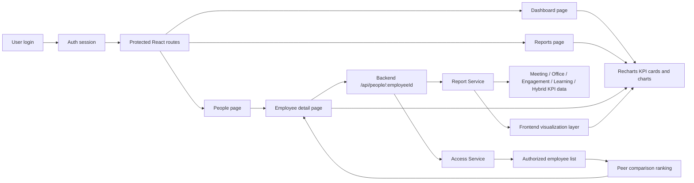
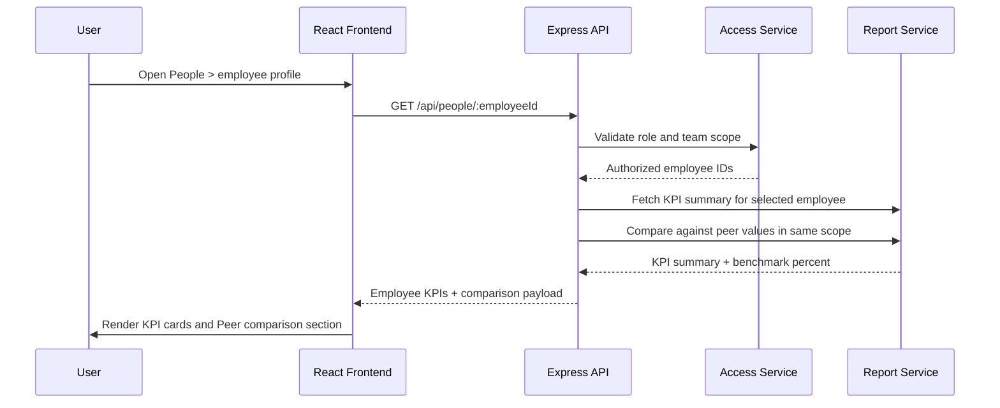

# Workplace Efficiency & Sustainability Dashboard

This project is a demo workplace analytics dashboard for employee, manager, and HR access levels. It combines a Node.js/Express API with a React + Vite frontend and uses Recharts for all dashboard visualizations.

## Project structure

- backend/: Express API with in-memory demo data and role-aware KPI reporting
- frontend/: React + Vite app with protected routes, dashboard pages, and reports

## System overview



## Prerequisites

- Node.js 18+
- npm

## Setup

1. Install dependencies:
   ```bash
   cd backend
   npm install

   cd ../frontend
   npm install
   ```

2. Start the backend API:
   ```bash
   cd backend
   npm start
   ```

3. Start the frontend app:
   ```bash
   cd frontend
   npm run dev
   ```

4. Open the frontend in the browser at http://localhost:5173

## Demo accounts

The backend exposes demo accounts for testing role-aware access.

- HR: EMP001 / demo-hr-2024
- Manager: EMP005 / demo-manager-2024
- Employee: EMP006 / demo-emp1-2024

## API endpoints

- POST /api/auth/login
- POST /api/auth/logout
- GET /api/auth/me
- GET /api/auth/demo-accounts
- GET /api/dashboard
- GET /api/reports/:kpi
- GET /api/people
- GET /api/people/:employeeId
- GET /api/health

## Scripts

Backend:

```bash
cd backend
npm start
npm test
```

Frontend:

```bash
cd frontend
npm run dev
npm run build
npm run test
```

## Employee peer-comparison flow



## Notes

- The app uses in-memory demo data and session-based mock authentication.
- Role scopes are enforced both in the frontend routes and in the backend.
- Recharts is the only data-visualization library used in the dashboard.
- The Peer comparison cards are shown on individual employee detail pages for authorized manager and HR users.
